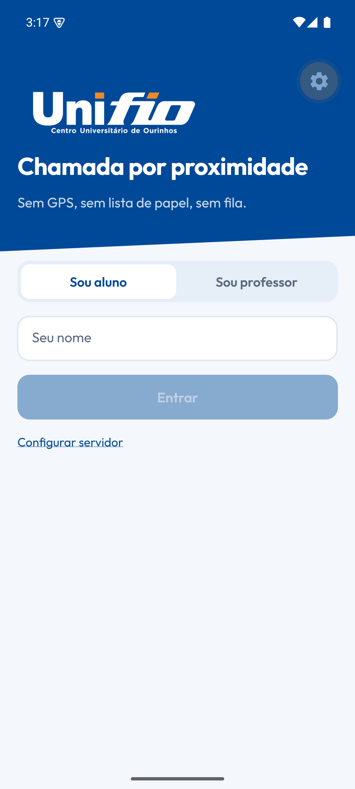
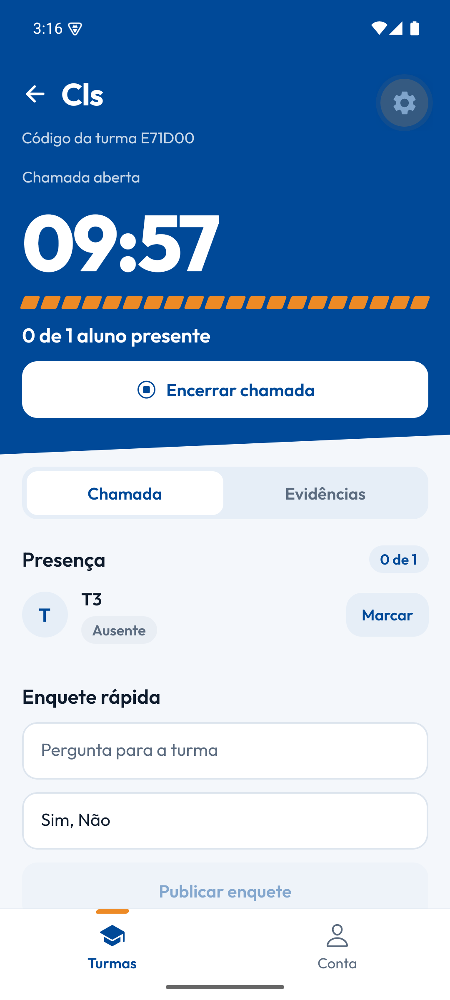
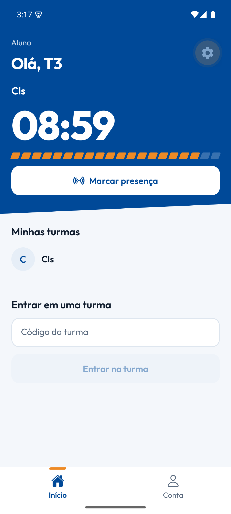
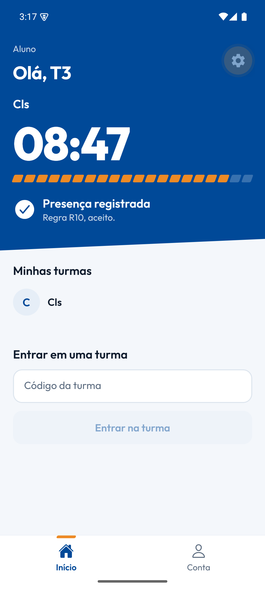

# Chamada Fio

Aplicativo Android de **chamada por proximidade, sem GPS**, para o Centro Universitário de Ourinhos (Unifio).
O professor abre a chamada; o aluno toca em **Marcar presença**; o sistema confere se ele está mesmo na sala e registra.

> **Estado: protótipo funcional.** O fluxo completo (professor, aluno, regras antifraude, banco de dados) funciona e é testado.
> O **Bluetooth real está implementado, mas ainda não foi testado em aparelho**; no emulador e no Expo Go a detecção continua simulada. Próximo passo: medir em sala ([ROADMAP](ROADMAP.md), [plano do Bluetooth](docs/bluetooth.md)).

<p>
  
  
  
  
</p>

## Como funciona

1. O professor cria a turma e passa o código aos alunos.
2. O professor toca em **Iniciar chamada** e escolhe a duração (2, 5 ou 10 min).
3. O aluno vê a chamada aberta e toca em **Marcar presença**.
4. O servidor aplica as regras abaixo e responde na hora, dizendo **qual regra decidiu**.
5. O professor acompanha a presença ao vivo, corrige à mão quando precisar e vê os alertas de fraude.

### Regras de validação (R1 a R10)

Executadas em ordem; a primeira que falha decide. Cada regra está rotulada em [`EVIDENCE.md`](EVIDENCE.md) como observada no Acadly, inferida ou decisão da Fio.

| Regra | O que confere |
|---|---|
| R1 | A sessão existe |
| R2 | A chamada está aberta e dentro da janela de tempo |
| R3 | O aluno está matriculado na turma |
| R4 | No máximo 5 tentativas por aparelho a cada 10 s |
| R5 | Um check-in por aluno |
| R6 | Um aparelho não registra dois alunos |
| R7 | O código de proximidade (muda a cada 5 s) é válido |
| R8 | No máximo 3 saltos até o professor |
| R9 | Quem chegou por salto tem uma testemunha já presente |
| R10 | Aceito |

## O que existe hoje

| | Estado |
|---|---|
| Regras, máquina de estados da chamada, validador | Pronto, com 21 testes |
| API (Fastify) + PostgreSQL | Pronto, com 14 testes de integração |
| App Android: professor, aluno, painel de Evidências, enquete, presença manual | Pronto, com identidade visual da Unifio |
| Simulação com 175 alunos concorrentes | Pronta: 100% de acerto, 0 fraude aceita |
| Detecção por **Bluetooth real** | **Implementado, sem teste em aparelho** (simulado no emulador) |
| Integração com Moodle e Portal | Não existe ainda |
| Modo Prova | Não existe ainda |

## Estrutura

```
packages/core    regras R1–R10, máquina de estados, validador (TypeScript puro)
apps/server      Fastify + Drizzle + PostgreSQL (PGlite em dev, Postgres em produção)
apps/mobile      Expo (React Native), Android
tests/           simulate_attendance.ts → relatório de acurácia
docs/            plano do Bluetooth e capturas de tela
```

## Rodar no emulador Android

```powershell
npm install

# 1) servidor na porta 3333. SIM_BEACON=1 só em desenvolvimento: simula o Bluetooth.
$env:SIM_BEACON=1; npm run server

# 2) app: abre no Expo Go do emulador. O endereço do servidor no emulador é http://10.0.2.2:3333
npm run mobile
```

No emulador, `10.0.2.2` é o computador. Em um celular real use o IP do computador na mesma rede Wi-Fi.
Para testar os dois papéis num aparelho só: **Conta → Sair da conta** e entre com o outro perfil.

## Testes

```bash
npm test            # 21 testes das regras + 14 de integração (API e banco)
npm run simulate    # 175 alunos concorrentes; gera tests/report.md e tests/report.json
```

## Banco de dados

PostgreSQL em todos os ambientes, com o mesmo schema (`apps/server/src/db`).

| Ambiente | Configuração |
|---|---|
| Desenvolvimento e testes | nada: PGlite (Postgres embutido) em `.data/pg`, ou em memória nos testes |
| Produção | `DATABASE_URL=postgres://...` |

Check-ins da mesma chamada são serializados (`pg_advisory_xact_lock`) e há `UNIQUE(sessão, aluno)` e `UNIQUE(sessão, aparelho)` como segunda barreira contra duplicata.

## Limites conhecidos

1. **Bluetooth ainda sem prova em aparelho.** No emulador/Expo Go o app busca o código no servidor (**não prova presença física**); em produção `SIM_BEACON` fica desligado.
2. **Sala ao lado e corredor** não são resolvidos hoje. A meta é ser melhor que a ATA em papel, não perfeito: ver [`docs/bluetooth.md`](docs/bluetooth.md).
3. **Login por nome, sem senha** (só para o protótipo). O destino é entrar com o RA e a senha do Moodle.
4. O `deviceId` é um identificador de instalação, não o serial do aparelho (Android e iOS não expõem esse dado).
5. A concorrência foi exercitada em PGlite; falta rodar a simulação contra um Postgres de verdade.
6. Só Android. iOS está fora do escopo por enquanto.

## Documentação

- [`ROADMAP.md`](ROADMAP.md): o que está pronto, o que vem e em que ordem.
- [`docs/bluetooth.md`](docs/bluetooth.md): como o Bluetooth vai funcionar e como testar com dois aparelhos.
- [`EVIDENCE.md`](EVIDENCE.md): o que o Acadly faz (só fontes públicas), regras e decisões da Fio.

## Identidade visual

Azul `#004998` e laranja `#ED8A25`, extraídos do logotipo oficial. Azul é ação e estrutura; laranja é atenção e progresso. Tipografia Outfit. As cores ficam em `apps/mobile/src/theme.ts`.
